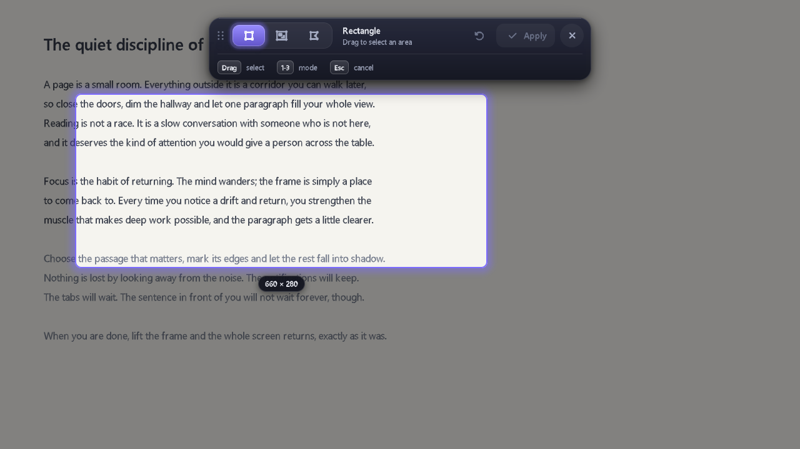
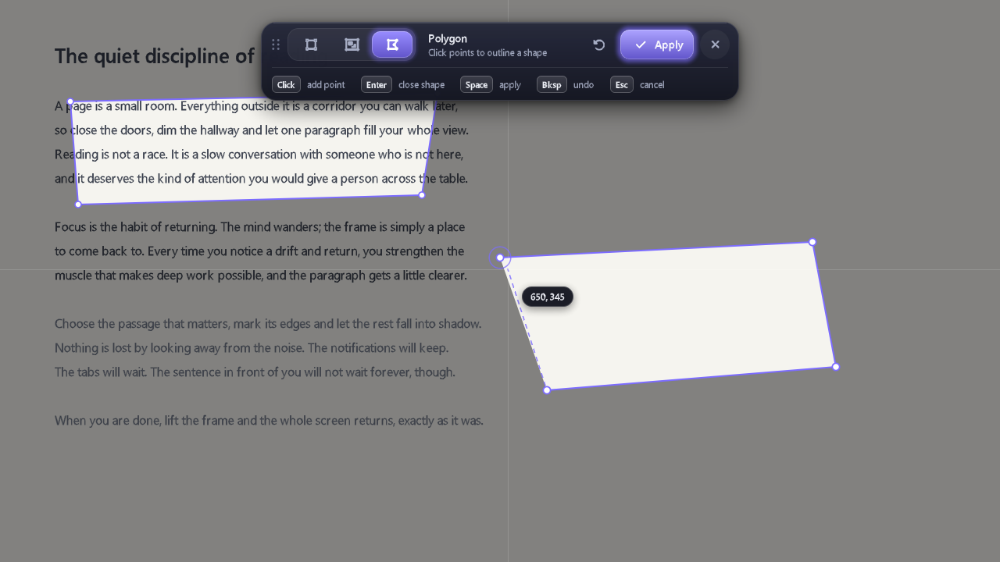
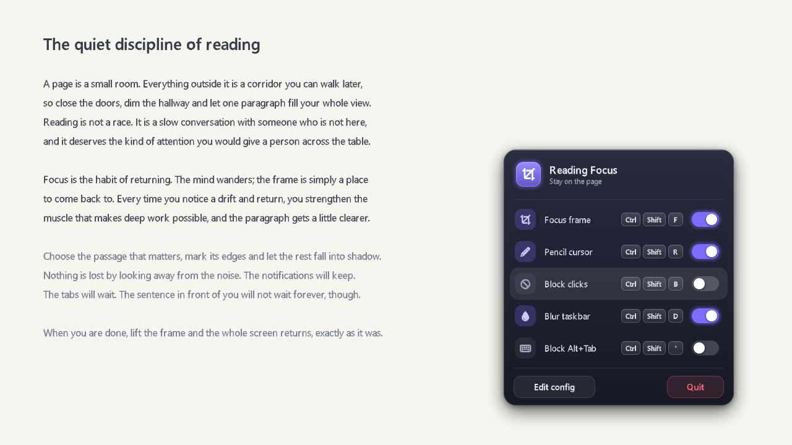

# Reading Focus Overlay

Dim everything except the text you are reading. A small Windows tool written in
[V](https://vlang.io): a focus frame you draw around the passage that matters,
plus a pencil cursor, a click blocker, an Alt+Tab blocker and a blurred taskbar.
Everything is controlled from the keyboard or from one tray panel.



## Run

Download or build `reading_focus_overlay.exe` and start it. It lives in the
system tray (the violet icon); click it for the control panel.

```powershell
.\reading_focus_overlay.exe
```

`reading_focus_overlay.exe` is the release build included in this repository.
To rebuild it you need the V toolchain in `C:\git\v` and the shared libraries in
`C:\git\v_projects\lib` (`vraster`, `vfonts`, `vfa_icons`):

```powershell
.\build.ps1            # release build -> reading_focus_overlay.exe
.\build.ps1 -Test      # unit tests
```

Starting a second copy replaces the running one.

## Hotkeys

| Keys | Action |
| --- | --- |
| `Ctrl+Shift+F` | Focus frame: start selecting, then show/hide the dimmer |
| `Shift+Esc` | Re-select the focus area |
| `Ctrl+Shift+R` | Pencil cursor |
| `Ctrl+Shift+B` | Block clicks |
| `Ctrl+Shift+D` | Blur the taskbar |
| `Ctrl+Shift+'` | Block Alt+Tab, Win+Tab, Ctrl+Alt+Tab |
| `Ctrl+Shift+P` | Control panel |
| `Ctrl+Shift+Q` | Quit |

### Typical session

Start a timer, enable the focus frame, read without distractions, capture the
key insights, repeat.

## Focus frame

Press `Ctrl+Shift+F`. The screen dims softly and a dock appears at the top
(drag its grip to move it). The dock shows the current mode, the keys that work
in it, and Undo / Apply / Close buttons. A crosshair and a coordinate badge
follow the cursor.

| Mode | Key | How it works |
| --- | --- | --- |
| Rectangle | `1` | Drag once; the selection is final on release. A badge shows its size |
| Multi-area | `2` | Drag several areas; `Enter` or **Apply** finishes, `Backspace` removes the last |
| Polygon | `3` | Click points; `Enter` or clicking the first point closes a shape, `Space` or **Apply** finishes, `Backspace` removes a point, `Shift+Backspace` a whole shape |

`4` or `Esc` cancels. You see each hole live while you draw it. When the frame
is final, the dim deepens, a ring pulses out from the new area, and the holes are
click-through, so you can still scroll and click inside them.



## Control panel

Click the tray icon (or press `Ctrl+Shift+P`) to switch every feature on or off
and see its shortcut. **Edit config** opens `config.ini`; **Quit** exits.



## Configuration

Hotkeys and a few looks live in `config.ini` next to the executable (or pass
`--config <file>`). Edit it and restart.

```powershell
.\reading_focus_overlay.exe --write-config   # write config.ini with the defaults
.\reading_focus_overlay.exe --print-config   # show the effective configuration
```

```ini
[Shortcuts]
HOTKEY_TOGGLE_FOCUS=^+F      ; ^ Ctrl, + Shift, ! Alt, # Win
HOTKEY_PANEL=^+P
[Appearance]
ACCENT=#7C6CFF               ; highlight colour
DIM_DRAG=120                 ; dim alpha while selecting (0-255)
DIM_FINAL=225                ; dim alpha once the frame is set (0-255)
PENCIL_MAX_EDGE=300
```

Mistakes in the file (unknown keys, bad numbers, bad colours, hotkeys another
program already owns) are shown in a toast instead of being ignored. The `'`
key follows your keyboard layout, so on some layouts it is awkward; bind another
key if so.

## How it is built

The rules and the pixels are separate from Windows:

| File | Role |
| --- | --- |
| `selection.v` | State machine: what clicks, keys and toggles do |
| `scene.v` | Turns the state into the full-screen overlay (dim, holes, guides, pulse) |
| `ui.v`, `kit.v` | Dock, control panel, toast, theme, icons and text |
| `anim.v` | Tweens that drive every animation |
| `config.v`, `geometry.v`, `imgutil.v` | Config/hotkey parsing, geometry, image helpers |
| `winlayer.c.v`, `app_win32.c.v`, `win32.c.v` | Windows: per-pixel layered windows, hooks, tray, hotkeys |
| `main.v` | Command line |

Drawing uses the shared `vraster` library (anti-aliased shapes, shadows,
gradients, polygons), `vfonts` (TrueType text; Segoe UI when installed) and
`vfa_icons` (Font Awesome icons). Each window is a per-pixel-alpha layer, so
shadows and the glass look are real transparency.

`reading_focus_overlay.exe --demo docs/screens/ui` renders the screenshots above
without a desktop.

## Tests

```powershell
.\build.ps1 -Test                                                   # unit tests
.\scripts\e2e_smoke.ps1 -Exe .\reading_focus_overlay.exe            # drives the real desktop
.\scripts\e2e_hooks.ps1 -Exe .\reading_focus_overlay.exe            # click/Alt+Tab block, blur
```

The end-to-end scripts briefly dim the screen and move the cursor. They remap
the few hotkeys other programs commonly own, and only send mouse input after the
first hotkey has been seen to work.

## History

This is a port of the AutoHotkey v2 tool by oxzoid, redesigned from scratch. The
AutoHotkey sources were removed; they remain in the git history.

## License

GPL-3.0, see [LICENSE](LICENSE).
